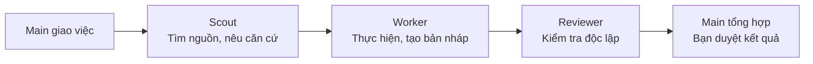
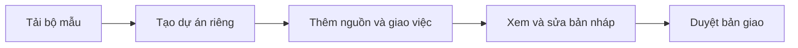

# LAW · Local Assistant Workspace

Workspace local cho công việc văn phòng với Claude, Codex, Gemini hoặc trợ lý AI bạn đang dùng. LAW kết nối tài liệu nguồn, kỹ năng, vai trò AI và bối cảnh dự án để làm việc qua nhiều phiên; bạn giữ quyền giao việc và duyệt kết quả.

[**Tải Prototype 1.9.0-rc4 cho Windows**](https://github.com/CVF-Ecosystem/local-agent-workspace/releases/tag/v1.9.0-rc4) · [Hướng dẫn](docs/README.md) · [Thử với dữ liệu mẫu](examples/demo-project/README.md) · [English](en/README.md)

**Bản dùng thử hiện hành: 1.9.0-rc4 — Prototype văn phòng Windows/DATAMOCK (prerelease).** Đã công bố ngày 24/10/2026, chưa phải stable/final. RC1/RC2 vẫn được giữ để tra cứu; stable/latest vẫn là [1.8.0](https://github.com/CVF-Ecosystem/local-agent-workspace/releases/latest). File `VERSION` trong gói RC ghi `1.9.0`; khi phản hồi hãy ghi tag `v1.9.0-rc4`.

[Gửi phản hồi trên GitHub](https://github.com/CVF-Ecosystem/local-agent-workspace/issues/new?template=phan-hoi.md) hoặc dùng [phiếu phản hồi có sẵn](docs/FEEDBACK_FORM_VI_EN.md). Ghi tag RC, hệ điều hành, phiên bản Python, ứng dụng AI và các bước tái hiện; che tên người, số liệu và thông tin nội bộ trước khi gửi.

## LAW giúp gì?

| Hỗ trợ | Lợi ích cho bạn |
|---|---|
| **Tài liệu và bảng tính** | Soạn quy trình, biểu mẫu, biên bản, báo cáo; xử lý Excel và báo cáo HTML bằng công cụ phù hợp. |
| **Thư viện nguồn** | Tra cứu, chọn và mở tài liệu; ghi nhận ID, revision và thay đổi của file nguồn. |
| **Vai trò AI** | Phân việc tìm nguồn, thực hiện và kiểm độc lập cho Scout, Worker, Reviewer khi hữu ích và đã được cấp quyền. |
| **Bối cảnh nhiều phiên** | Giữ mục tiêu, quyết định và việc đang dở để tiếp tục mà không phải dựng lại toàn bộ bối cảnh. |
| **Kỹ năng và gói lĩnh vực** | Bổ sung mẫu, quy tắc nghiệp vụ và nguồn theo nhu cầu; gói thử cần được tiếp nhận trước khi dùng chính thức. |
| **Quản lý dự án** | Tạo dự án riêng từ bộ mẫu; xem trước thay đổi, nâng cấp và xử lý xung đột qua các công cụ đi kèm. |

Trợ lý AI dùng công cụ và kỹ năng phù hợp; LAW bổ sung hướng dẫn, mẫu và quy tắc giữ nguồn gốc, không bịa dữ kiện.

## Subagent và vai trò phối hợp ra sao?

Main là trợ lý chính bạn trao đổi. Khi cần phân vai, Main giao phần việc có phạm vi rõ, nhận kết quả và tổng hợp để bạn xem xét.

Đây là một luồng minh họa; việc nhỏ Main có thể làm trực tiếp, không bắt gọi đủ ba vai. Nguồn dùng chung, vùng được ghi và tiêu chí nhận kết quả phải được xác định khi giao việc.

**Mức hoàn thiện:** Main có bộ phương pháp cho khảo sát nguồn, thư ký tổng hợp, thư tín, thị trường, số liệu và đối chiếu. Các luồng đại diện đã được kiểm với DATAMOCK, gồm giao việc, kiểm kết quả, yêu cầu sửa, tiếp phiên và dùng lại ở project khác. Đã có hợp đồng vai, profile chọn host/model và công cụ xuất cấu hình native; bằng chứng gọi vai trong lab có giới hạn theo host. Vai trò không tự cấp quyền, review không thay việc bạn duyệt nội dung; chưa nghiệm thu usability của người thật hoặc hỗ trợ mọi ứng dụng AI. Xem [hợp đồng vai](roles/README.md) và [tích hợp native](tools/README.md#native_agentspy).

## Phạm vi RC4 và phần còn lại

RC4 là Prototype văn phòng dùng DATAMOCK đã phát hành. Gói tải có ZIP, báo cáo `.gate.json` gắn nguồn `2552d7d` và file checksum; đọc báo cáo đi kèm đúng ZIP để biết các cổng đã chạy. Test đạt không thay việc duyệt nội dung.

| Phần | Phạm vi đã kiểm và giới hạn |
|---|---|
| Môi trường Windows | Đã kiểm cục bộ trên Windows/NTFS/Python 3.11.9 và CI Windows Server 2025/Python 3.12.10. Windows/Python 3.8 và macOS/Python 3.12 còn lỗi, chưa được nhận hỗ trợ cho Prototype. |
| Gate và CI | Gói RC4 sạch đạt 4/4 gate; bộ kiểm hành vi chạy 1.622 test, 6 skip. [CI 39985758160](https://github.com/CVF-Ecosystem/local-agent-workspace/actions/runs/39985758160) toàn run FAILURE: 3/5 job đạt (Ubuntu/Python 3.8, Ubuntu/Python 3.12, Windows/Python 3.12). Hai job Ubuntu có 447 skip mỗi lượt; không chứng minh đầy đủ nghiệp vụ văn phòng trên Linux. |
| Công việc nghiệp vụ | Có ca DATAMOCK báo cáo, số liệu CSV/Decimal, so sánh giá và nháp thư được kiểm. Đây là các ca cụ thể; không chứng minh mọi nghiệp vụ hoặc dữ liệu thật. Nháp thư không gửi hay thao tác hộp thư. |
| Hồ sơ công việc | Xem phần việc, kết quả, quyết định và phần chờ từ hồ sơ được dẫn; tiếp process mới và giữ chờ khi nguồn/revision đổi. Trang chỉ đọc, không gọi AI hoặc đổi nháp; nút tiếp/dừng chỉ sao chép yêu cầu Main, chưa dừng host. |
| Dùng lại và bảo toàn | Đã thử phương pháp ở project khác và new/adopt/upgrade trên bản sao có dữ liệu riêng: giữ dữ liệu/lựa chọn/native riêng, không mang dữ liệu hoặc quyền project A sang B. Mock không chứng minh trải nghiệm người dùng thật. |
| Host và quyền | Hợp đồng/profile/công cụ xuất cấu hình không tự chứng minh host đã đăng ký hoặc gọi đúng chuyên viên. Chưa xác nhận enforcement, sandbox hay hỗ trợ mọi ứng dụng AI; thiếu quyền/capability phải giữ chờ. |
| Liên kết tệp và giới hạn | Năm ca file-symlink bị skip do thiếu quyền trên máy local đã được quan sát đạt trên CI Windows/Python 3.12 của đúng nguồn 2552d7d. Kết quả này không chứng minh mọi môi trường hoặc loại bỏ TOCTOU và giới hạn hợp tác. |

Phần kỹ thuật của các luồng đại diện và tái dùng đã được nhận có giới hạn. RC4 đã công bố; phần còn lại là trải nghiệm/nghiệm thu người thật, hiện pilot chưa chạy. Việc phát hành stable/final và nghiệm thu toàn sản phẩm vẫn còn mở; không coi RC4 hoặc CI đạt một phần là toàn roadmap đã hoàn tất.

## Bắt đầu

1. **Tải ZIP và giải nén** vào một thư mục làm bộ mẫu; giữ bộ mẫu để tạo các dự án sau.
2. **Mở `APP.bat` trên Windows.** Nhập tên công việc → xem trước → tạo dự án riêng.
3. **Trong dự án mới,** đặt tài liệu vào `references/`, mở thư mục bằng ứng dụng AI và giao việc. Xem, sửa và duyệt kết quả trước khi sử dụng.

Phiên sau, mở APP trong **dự án** và dùng mục **Tiếp tục công việc**. Muốn đọc cẩm nang trên máy, mở `START_HERE.html` hoặc `START_HERE.en.html` sau khi giải nén.

**Môi trường RC4 đã kiểm:** Windows với Python 3.11.9 hoặc 3.12.10 như ma trận trên; không suy hỗ trợ Windows/Python 3.8 hoặc macOS từ việc có sẵn launcher hoặc kiểm tương thích tĩnh. Công cụ Excel và thư viện nguồn cần thêm `openpyxl`. Không có Python vẫn có thể sao chép bộ mẫu và làm việc trực tiếp với AI — xem [hướng dẫn tạo dự án](docs/HUONG_DAN_TAO_PROJECT_MOI_VI.md).

## File nằm ở đâu?

| Nơi lưu | Nội dung |
|---|---|
| `references/` | Tài liệu nguồn và mẫu nghiệp vụ |
| `working/` | Bản nháp, phần việc đang làm |
| `output/` | Bản giao hiện hành |
| `archive/` | Bản cũ cần giữ |
| `PROJECT.md` · `.agent/STATE.md` | Bối cảnh ổn định · tiến độ để tiếp tục |

## Hướng dẫn theo nhu cầu

| Bạn muốn… | Xem tại |
|---|---|
| Tạo dự án đầu tiên | [Tạo dự án mới](docs/HUONG_DAN_TAO_PROJECT_MOI_VI.md) |
| Giao việc, dùng nguồn và tiếp tục phiên sau | [Sử dụng hằng ngày](docs/HUONG_DAN_SU_DUNG_VI.md) |
| Đưa công việc có sẵn vào LAW hoặc nâng cấp | [Chuyển đổi và nâng cấp](docs/HUONG_DAN_CHUYEN_DOI_PROJECT_CO_SAN_VI.md) |
| Chọn kỹ năng, mẫu hoặc gói lĩnh vực | [Kỹ năng](docs/HUONG_DAN_SKILLS_VI.md) · [Gói lĩnh vực](packs/README.md) |
| Thử trước khi dùng tài liệu thật | [Bài thực hành với dữ liệu mẫu](examples/demo-project/README.md) |
| Gửi phản hồi | [Phiếu góp ý](docs/FEEDBACK_FORM_VI_EN.md) · [GitHub Issues](https://github.com/CVF-Ecosystem/local-agent-workspace/issues) |

## Mở rộng và bảo trì

[Kỹ năng và chuẩn tiếp nhận](skills/README.md) · [Vai Scout / Worker / Reviewer và trạng thái tích hợp](roles/README.md) · [Công cụ bảo trì](tools/README.md) · [Lịch sử thay đổi](CHANGELOG.md) · [Nguồn tham khảo](docs/NGUON_THAM_KHAO_VI.md)

Tài liệu lưu local không có nghĩa mô hình AI chạy offline. Khả năng đọc file, dùng công cụ và gọi vai phụ thuộc ứng dụng AI cùng quyền bạn đã cấp.

Giấy phép [MIT](LICENSE).
