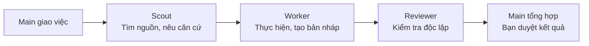
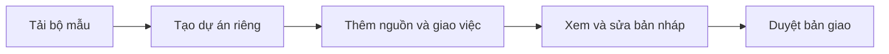

# LAW · Local Assistant Workspace

Workspace local cho công việc văn phòng với Claude, Codex, Gemini hoặc trợ lý AI bạn đang dùng. LAW kết nối tài liệu nguồn, kỹ năng, vai trò AI và bối cảnh dự án để làm việc qua nhiều phiên; bạn giữ quyền giao việc và duyệt kết quả.

[**Tải bản dùng thử 1.9.0-rc2**](https://github.com/CVF-Ecosystem/local-agent-workspace/releases/tag/v1.9.0-rc2) · [Hướng dẫn](docs/README.md) · [Thử với dữ liệu mẫu](examples/demo-project/README.md) · [English](en/README.md)

**Bản dùng thử đề xuất: 1.9.0-rc2 (prerelease), chưa phải bản final.** RC2 thay RC1 trong hướng dẫn tải và thu phản hồi; RC1 vẫn được giữ để tra cứu. Bản stable hiện là [1.8.0](https://github.com/CVF-Ecosystem/local-agent-workspace/releases/latest). File `VERSION` trong gói RC vẫn ghi `1.9.0`; khi phản hồi hãy ghi thêm tag `v1.9.0-rc2`.

[Gửi phản hồi trên GitHub](https://github.com/CVF-Ecosystem/local-agent-workspace/issues/new?template=phan-hoi.md) hoặc dùng [phiếu phản hồi có sẵn](docs/FEEDBACK_FORM_VI_EN.md). Ghi tag RC, hệ điều hành, phiên bản Python, ứng dụng AI và các bước tái hiện; che tên người, số liệu và thông tin nội bộ trước khi gửi.

## LAW giúp gì?

| Hỗ trợ | Lợi ích cho bạn |
|---|---|
| **Tài liệu và bảng tính** | Soạn quy trình, biểu mẫu, biên bản, báo cáo; xử lý Excel và báo cáo HTML bằng công cụ phù hợp. |
| **Thư viện nguồn** | Tra cứu, chọn và mở tài liệu; ghi nhận ID, revision và thay đổi của file nguồn. |
| **Vai trò AI** | Phân việc tìm nguồn, thực hiện và kiểm độc lập cho Scout, Worker, Reviewer khi hữu ích và đã được cấp quyền. |
| **Bối cảnh nhiều phiên** | Giữ mục tiêu, quyết định và việc đang dở để tiếp tục mà không phải dựng lại toàn bộ bối cảnh. |
| **Kỹ năng và gói lĩnh vực** | Bổ sung mẫu, quy tắc nghiệp vụ và nguồn theo nhu cầu; gói thử cần được tiếp nhận trước khi dùng chính thức. |
| **Quản lý dự án** | Tạo dự án riêng từ bộ mẫu; xem trước thay đổi, nâng cấp và xử lý xung đột qua các công cụ đi kèm. |

Trợ lý AI dùng công cụ và kỹ năng phù hợp; LAW bổ sung hướng dẫn, mẫu và quy tắc giữ nguồn gốc, không bịa dữ kiện.

## Subagent và vai trò phối hợp ra sao?

Main là trợ lý chính bạn trao đổi. Khi cần phân vai, Main giao phần việc có phạm vi rõ, nhận kết quả và tổng hợp để bạn xem xét.

Đây là một luồng minh họa; việc nhỏ Main có thể làm trực tiếp, không bắt gọi đủ ba vai. Nguồn dùng chung, vùng được ghi và tiêu chí nhận kết quả phải được xác định khi giao việc.

**Mức hoàn thiện:** đã có hợp đồng ba vai, profile chọn host/model và công cụ xuất cấu hình native; luồng gọi Scout, Worker và Reviewer đã được kiểm trong lab Claude Code trên Windows. Phần task/result và xử lý gián đoạn đang hoàn thiện; chưa tự hoạt động trên mọi ứng dụng AI. Vai trò không tự cấp quyền và review không thay việc bạn duyệt nội dung. Xem [hợp đồng vai](roles/README.md) và [tích hợp native](tools/README.md#native_agentspy).

## Bắt đầu

1. **Tải ZIP và giải nén** vào một thư mục làm bộ mẫu; giữ bộ mẫu để tạo các dự án sau.
2. **Mở `APP.bat` trên Windows hoặc `APP.command` trên macOS.** Nhập tên công việc → xem trước → tạo dự án riêng.
3. **Trong dự án mới,** đặt tài liệu vào `references/`, mở thư mục bằng ứng dụng AI và giao việc. Xem, sửa và duyệt kết quả trước khi sử dụng.

Phiên sau, mở APP trong **dự án** và dùng mục **Tiếp tục công việc**. Muốn đọc cẩm nang trên máy, mở `START_HERE.html` hoặc `START_HERE.en.html` sau khi giải nén.

**Yêu cầu:** bảng điều khiển cần Python 3.8+; công cụ Excel và thư viện nguồn cần thêm `openpyxl`. Không có Python vẫn có thể sao chép bộ mẫu và làm việc trực tiếp với AI — xem [hướng dẫn tạo dự án](docs/HUONG_DAN_TAO_PROJECT_MOI_VI.md).

## File nằm ở đâu?

| Nơi lưu | Nội dung |
|---|---|
| `references/` | Tài liệu nguồn và mẫu nghiệp vụ |
| `working/` | Bản nháp, phần việc đang làm |
| `output/` | Bản giao hiện hành |
| `archive/` | Bản cũ cần giữ |
| `PROJECT.md` · `.agent/STATE.md` | Bối cảnh ổn định · tiến độ để tiếp tục |

## Hướng dẫn theo nhu cầu

| Bạn muốn… | Xem tại |
|---|---|
| Tạo dự án đầu tiên | [Tạo dự án mới](docs/HUONG_DAN_TAO_PROJECT_MOI_VI.md) |
| Giao việc, dùng nguồn và tiếp tục phiên sau | [Sử dụng hằng ngày](docs/HUONG_DAN_SU_DUNG_VI.md) |
| Đưa công việc có sẵn vào LAW hoặc nâng cấp | [Chuyển đổi và nâng cấp](docs/HUONG_DAN_CHUYEN_DOI_PROJECT_CO_SAN_VI.md) |
| Chọn kỹ năng, mẫu hoặc gói lĩnh vực | [Kỹ năng](docs/HUONG_DAN_SKILLS_VI.md) · [Gói lĩnh vực](packs/README.md) |
| Thử trước khi dùng tài liệu thật | [Bài thực hành với dữ liệu mẫu](examples/demo-project/README.md) |
| Gửi phản hồi | [Phiếu góp ý](docs/FEEDBACK_FORM_VI_EN.md) · [GitHub Issues](https://github.com/CVF-Ecosystem/local-agent-workspace/issues) |

## Mở rộng và bảo trì

[Kỹ năng và chuẩn tiếp nhận](skills/README.md) · [Vai Scout / Worker / Reviewer và trạng thái tích hợp](roles/README.md) · [Công cụ bảo trì](tools/README.md) · [Lịch sử thay đổi](CHANGELOG.md) · [Nguồn tham khảo](docs/NGUON_THAM_KHAO_VI.md)

Tài liệu lưu local không có nghĩa mô hình AI chạy offline. Khả năng đọc file, dùng công cụ và gọi vai phụ thuộc ứng dụng AI cùng quyền bạn đã cấp.

Giấy phép [MIT](LICENSE).
